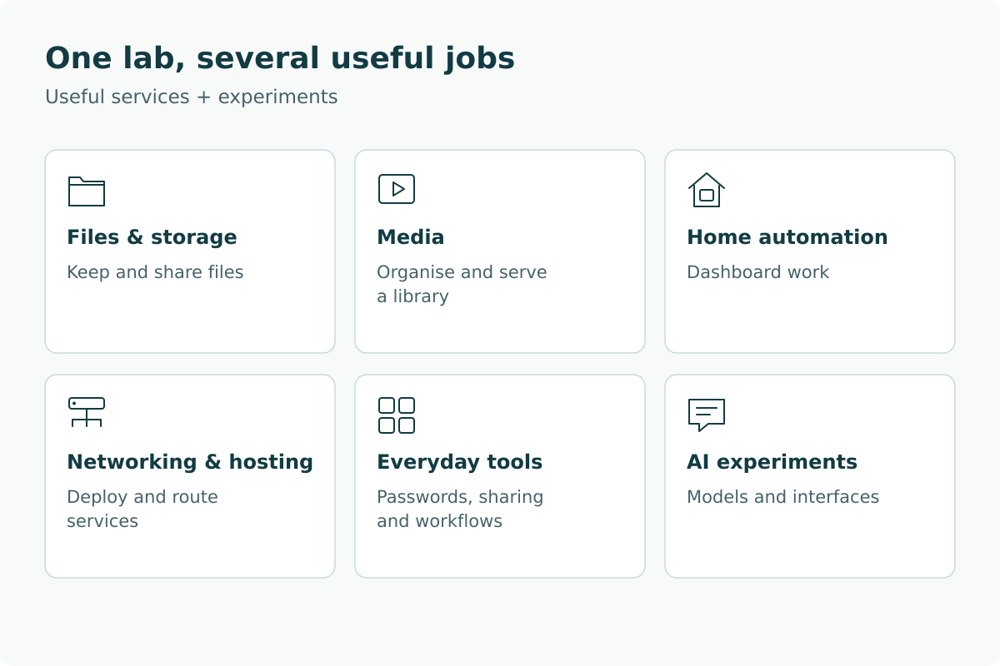
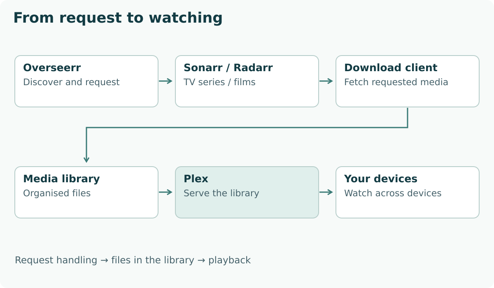
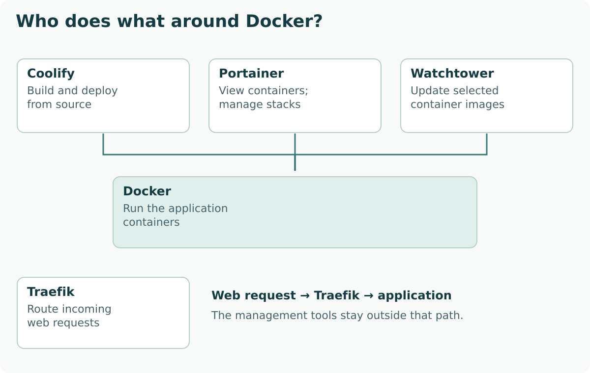

I enjoy running things myself and figuring out how they work. That's the simplest explanation for the home lab. Useful services give me something concrete to learn with, beyond getting an application to start and calling it finished.

Subscriptions are part of the appeal too. A small monthly charge can be reasonable on its own, then become one of several renewals competing for attention. Having another way to do some of those jobs is worth exploring. That doesn't mean a server makes everything cheaper, or that paying someone else to maintain a service is a bad choice.

This is an introduction to the wider setup: files, media, small everyday tools, hosting and automation work. AI has a place in it, but the rest deserves an explanation too.

## What is a home lab?

A home lab is a place to run useful services and try things on computers you manage yourself. It can be part learning space, part everyday infrastructure; you don't need a rack full of equipment to begin.

With a hosted service, someone else runs the application for you. With self-hosting, you take on that job, including deciding how it gets updated and what happens to its data.

I find it more helpful to group the setup by what it's for than by which machine or container runs each piece. Files and storage are one group; media is another. Everyday utilities sit alongside hosting tools, home-automation work and model experiments.

*The main jobs in the lab, grouped by purpose rather than network layout. This is a snapshot of configured services and explored work, not a claim of daily use. Home automation reflects reported dashboard work, not a newly verified live setup.*

Most of the named applications are other people's software. Hosting and connecting them is different from writing them.

## Can self-hosting replace subscriptions?

It can replace some functions, but it doesn't automatically make them cheaper. The comparison includes the machine, electricity, storage and backups, maintenance, and any paid services you keep.

Start with the job you're paying for. Keeping files available across devices is a different problem from getting a licensed entertainment catalogue. Running a media server doesn't provide the catalogue, and installing an application doesn't reproduce a provider's support service.

Small recurring charges deserve attention, especially when an annual renewal makes them easy to forget. Citizens Advice's March 2024 research documented accidental subscriptions as a consumer problem; that's wider context, not a description of my own bills.[[21]](https://www.citizensadvice.org.uk/about-us/media-centre/press-releases/consumers-spend-688-million-on-unused-subscriptions-in-the-last-year/) Prices can change, but a useful comparison doesn't need the claim that every subscription gets more expensive every year.

There are several costs on the other side. Hardware wears out. More storage costs money, and a second copy needs somewhere to live. A machine that stays on uses electricity even when you're doing something else. Then there's the time spent updating an application or working out why an upgrade changed its behaviour.

Learning may be a good reason to spend that time. It still belongs in the decision. If the same hour feels like an interesting project to one person and unpaid support work to another, they'll reasonably reach different answers.

For a service you're considering replacing, write down what you actually need from it. Include sharing, recovery and access when you're away, if those matter. Compare that with what you're prepared to maintain, rather than comparing a monthly fee with a free download. Keeping a paid service for convenience or support can be the sensible outcome.

I'm not putting a savings total on this setup. Without measured running costs and specific subscriptions replaced, that number would suggest more than it tells us.

## The everyday jobs behind the apps

The services are easier to understand through the things they help with. A few representative examples explain more than a long inventory of container names.

### Files and storage

Nextcloud and Samba are examples from my configured services. They belong in the same broad group, but the reader's question comes first: do you need an application for accessing and sharing files, or a shared folder that other computers can use?

Those needs lead to different choices about access and accounts. They also lead to a separate question about recovery. Putting files on a server isn't, by itself, a backup plan. Before relying on a storage setup, decide which files matter and how you'd recover them after a failed disk or an accidental deletion. An app name won't answer that.

### Media

Plex is the front end I use for watching my library across devices and accessing it remotely. The other applications do the organising around it: Overseerr handles discovery and requests, Sonarr manages TV series, and Radarr manages films.[[30]](https://github.com/sct/overseerr)

A request starts in Overseerr. Once approved, it can go to Sonarr or Radarr, which work with a configured download client and organise the resulting files into the library. Plex picks up that library and makes it available to watch. The request and the media file take different paths: the video doesn't pass through Overseerr on its way to the screen.

*Overseerr manages the request; Plex serves the library. The middle steps depend on the configured download client and storage. This shows the roles, rather than a map of network connections.*

That division of jobs is why a list of containers doesn't explain much on its own. Each application has a fairly small part to play; the useful bit is connecting them. Running the software still doesn't supply a licensed entertainment catalogue or the rights to its contents.

### Home automation

Home Assistant dashboard work is another part of the lab's history, rather than a live setup I'm demonstrating here. The interesting question is how to bring useful controls and information together without making the interface harder to use than the things it controls.

A dashboard's appearance and the behaviour behind its buttons are different things to check. A future walkthrough would need to show what actually works, not just a tidy screen. For this introduction, it belongs as one area of practical experimentation, without a tour of devices or household layout.

### Small tools

Vaultwarden and PrivateBin are examples of the smaller utilities I've configured, for password management and temporary text sharing. They're less visually impressive than a wall of dashboards, but the jobs are easy to recognise.

Their importance changes the maintenance decision. A temporary text-sharing tool and a password service don't deserve the same tolerance for an experiment going wrong. Before depending on either, think about who needs access, what data it holds and how you'll recover it. A small interface can still carry a large responsibility.

There are automation tools in the wider setup too, including n8n and ntfy. Their presence isn't a claim that a particular workflow runs successfully from beginning to end. A useful walkthrough would follow one real job through its trigger, action and result rather than stop at the installation screen.

## Where does AI fit?

It's one area of experimentation alongside the everyday services. Running a model means using model software to take an input and generate an answer; the interface you type into can be separate from the computer doing that work.

The setup includes an always-on server and a separate GPU workstation for local model experiments. That separation matters: the workstation being available is a condition, not something to assume just because a web interface loads.

Ollama and Open WebUI are among the third-party tools I've configured in this area. A browser interface alone doesn't tell you where an answer is generated. Ollama's documentation distinguishes local processing from cloud-hosted models, so that choice needs checking rather than inferring from where the page is hosted.[[10]](https://docs.ollama.com/faq)

Cloud services remain an option where they're useful. Which machine or service to use depends on what the task needs. I don't have measured speed or cost comparisons to offer here, or a tested automatic fallback to demonstrate.

This part deserves its own closer look, without turning every file share and utility into an AI project.

## How do the pieces connect?

Docker runs the containers. Coolify and Portainer help me manage them, but I use them for different jobs: some projects I write live in Coolify for builds and deployment from source, while Portainer gives me a wider view of the containers and controls for managing them. Some open-source services are deployed through Portainer too.[[1]](https://docs.docker.com/get-started/docker-concepts/the-basics/what-is-a-container/)[[31]](https://docs.portainer.io/)

A Docker container is an isolated process with the files it needs to run.[[1]](https://docs.docker.com/get-started/docker-concepts/the-basics/what-is-a-container/) It helps to separate that runtime from the tools around it. Coolify can connect a source repository to an application deployment; Portainer provides an interface for working with containers and stacks.[[32]](https://coolify.io/docs/applications/sources/github/overview)[[31]](https://docs.portainer.io/) This is how I've divided up the work, rather than a rule about what either product can do.

Watchtower handles image updates for selected services. It pulls an updated image and recreates the container using its existing options.[[33]](https://containrrr.dev/watchtower/) That's useful maintenance automation, but it doesn't make an update harmless: checking compatibility and knowing how to recover still matter.

Traefik has a different job again. It's the reverse proxy for web requests, sending them to the matching application. Its Docker integration reads routing information from container labels, and Coolify configures its integrated proxy for the applications it manages.[[2]](https://doc.traefik.io/traefik/reference/install-configuration/providers/docker/)[[3]](https://coolify.io/docs/core/networking/proxy/traefik/overview)

*These are responsibilities around the containers, not successive stops in a request. A browser request goes through the configured proxy to the application; it doesn't travel through every management tool.*

For a simple web visit, DNS helps the browser find an address. The browser then sends its request, the proxy selects the matching application, and the application handles it. DNS isn't carrying the page through each of those steps. Coolify's management interface isn't a mandatory stop on the way to the application either.

HTTPS adds another distinct concern. Coolify can arrange certificate requests and renewals through its integrated proxy, with the required domain and network configuration in place.[[5]](https://coolify.io/docs/core/networking/domains) An encrypted connection doesn't decide who may log in; authentication needs its own configuration.[[11]](https://coolify.io/docs/core/networking/proxy/traefik/basic-auth) Nor does a certificate prove that the application behind it is doing useful work.

That's enough machinery for an introduction. Detailed settings make more sense when attached to one service and one request you can follow, rather than a diagram of every connection in the house.

## What comes next?

A closer look at how one service goes from deployment to a reachable URL would be a useful next step. It would give the Docker, Coolify and Traefik pieces a concrete job, including where the application's data lives and what to check when the page doesn't load.

For now, the reason I run the lab is still fairly simple: I enjoy self-hosting and learning how things fit together. The useful services give that learning a purpose. Whether any particular one earns a permanent place depends on what it does and what it asks me to maintain.

## Sources

- **[1]** [Docker: What is a container?](https://docs.docker.com/get-started/docker-concepts/the-basics/what-is-a-container/)
- **[2]** [Traefik: Docker provider](https://doc.traefik.io/traefik/reference/install-configuration/providers/docker/)
- **[3]** [Coolify: Traefik overview](https://coolify.io/docs/core/networking/proxy/traefik/overview)
- **[5]** [Coolify: Domains](https://coolify.io/docs/core/networking/domains)
- **[10]** [Ollama: FAQ — local and cloud processing](https://docs.ollama.com/faq)
- **[11]** [Coolify: Basic authentication](https://coolify.io/docs/core/networking/proxy/traefik/basic-auth)
- **[21]** [Citizens Advice: Unused subscriptions (8 March 2024)](https://www.citizensadvice.org.uk/about-us/media-centre/press-releases/consumers-spend-688-million-on-unused-subscriptions-in-the-last-year/)
- **[30]** [Overseerr: Plex, Sonarr and Radarr integrations](https://github.com/sct/overseerr)
- **[31]** [Portainer: Container management documentation](https://docs.portainer.io/)
- **[32]** [Coolify: GitHub source integration](https://coolify.io/docs/applications/sources/github/overview)
- **[33]** [Watchtower: Image update workflow](https://containrrr.dev/watchtower/)
